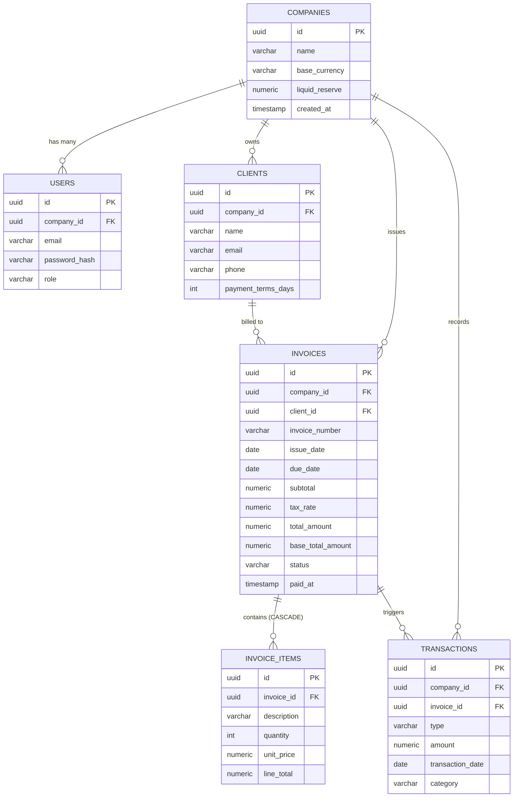
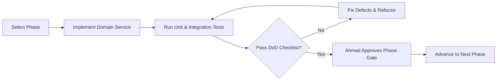

# FinFlow — Next.js 16 & PostgreSQL Master Implementation Plan
## Business Cash Flow Intelligence & Invoice SaaS
**Student:** Ahmad Aamir (`AF25LHB4554`)  
**Course:** CS2682 — Web Application Development  
**Architectural Paradigm:** Next.js 16 (Active LTS) App Router + PostgreSQL + Autonomous Microservice Domains  
**Status:** Living Engineering Blueprint & Execution Roadmap  

---

## Table of Contents
1. [Executive Summary & Architectural Paradigm](#1-executive-summary--architectural-paradigm)
2. [Target Tech Stack & Tooling (Next.js 16 Ecosystem)](#2-target-tech-stack--tooling-nextjs-16-ecosystem)
3. [Next.js 16 Core Architectural Primitives & Guidelines](#3-nextjs-16-core-architectural-primitives--guidelines)
   - [3.1 Cache Components Paradigm (`'use cache'`, `cacheLife`, `cacheTag`)](#31-cache-components-paradigm-use-cache-cachelife-cachetag)
   - [3.2 Multi-Tenant Cache Isolation & Leak Prevention](#32-multi-tenant-cache-isolation--leak-prevention)
   - [3.3 Strictly Asynchronous Request APIs (`await params`, `await cookies()`)](#33-strictly-asynchronous-request-apis-await-params-await-cookies)
   - [3.4 React 19 Native Actions & Optimistic State (`useActionState`, `useOptimistic`)](#34-react-19-native-actions--optimistic-state-useactionstate-useoptimistic)
4. [Global Database Topology (PostgreSQL 3NF)](#4-global-database-topology-postgresql-3nf)
5. [Phase-by-Phase Modular Implementation Plan](#5-phase-by-phase-modular-implementation-plan)
   - [Phase 0: Infrastructure, Base Scaffolding & Database Connection](#phase-0-infrastructure-base-scaffolding--database-connection)
   - [Phase 1: Microservice Domain 1 — Multi-Tenant Identity & Auth Service (`auth-tenant-service`)](#phase-1-microservice-domain-1--multi-tenant-identity--auth-service-auth-tenant-service)
   - [Phase 2: Microservice Domain 2 — Client Directory & CRM Service (`client-crm-service`)](#phase-2-microservice-domain-2--client-directory--crm-service-client-crm-service)
   - [Phase 3: Microservice Domain 3 — Invoicing Engine & Multi-Currency Service (`invoicing-service`)](#phase-3-microservice-domain-3--invoicing-engine--multi-currency-service-invoicing-service)
   - [Phase 4: Microservice Domain 4 — Document Generation & PDF Engine Service (`document-service`)](#phase-4-microservice-domain-4--document-generation--pdf-engine-service-document-service)
   - [Phase 5: Microservice Domain 5 — Treasury Ledger & 30-Day Forward Cash Flow Engine (`treasury-forecast-service`)](#phase-5-microservice-domain-5--treasury-ledger--30-day-forward-cash-flow-engine-treasury-forecast-service)
   - [Phase 6: Microservice Domain 6 — Visual Calendar & Scheduling Service (`schedule-calendar-service`)](#phase-6-microservice-domain-6--visual-calendar--scheduling-service-schedule-calendar-service)
   - [Phase 7: Microservice Domain 7 — Real-Time Synchronizer & Automated Reminders Service (`notification-sync-service`)](#phase-7-microservice-domain-7--real-time-synchronizer--automated-reminders-service-notification-sync-service)
   - [Phase 8: Microservice Domain 8 — Production Hardening, Security Audit & E2E Testing](#phase-8-microservice-domain-8--production-hardening-security-audit--e2e-testing)
6. [Phase 9: Academic Viva Defense & Examination Blueprint (Next.js 16 Focus)](#6-phase-9-academic-viva-defense--examination-blueprint-nextjs-16-focus)
7. [Execution Protocol: Phase Gate Workflow](#7-execution-protocol-phase-gate-workflow)

---

## 1. Executive Summary & Architectural Paradigm

FinFlow is an enterprise-grade FinTech SaaS engineered to solve the existential liquidity crisis facing Small and Medium Enterprises (SMEs). Instead of relying on static, backward-looking accrual bookkeeping (where invoices are recorded as revenue before payment is collected), FinFlow operates as a forward-looking liquid treasury cockpit.

### The Modular Microservice Architecture Pattern (Modular Monolith)
To achieve industrial-grade reliability, ease of grading, and zero technical debt, the application is structured as a **Modular Monolith partitioned into autonomous Domain Microservices** built atop the **Next.js 16 App Router**.

```
finflow/
├── next.config.ts                # Next.js 16 Config (cacheComponents: true, Turbopack)
├── src/
│   ├── app/                      # Next.js 16 App Router (RSC, Async Route Handlers, Layouts)
│   │   ├── (auth)/               # Auth route group
│   │   ├── (dashboard)/          # Authenticated app shell
│   │   └── api/                  # REST & SSE stream endpoints
│   ├── modules/                  # Autonomous Microservice Domains
│   │   ├── auth/                 # Domain 1: Multi-Tenant Identity & RBAC
│   │   ├── clients/              # Domain 2: Client Directory & CRM Ledger
│   │   ├── invoices/             # Domain 3: Atomic Invoicing Engine & Currency Rates
│   │   ├── documents/            # Domain 4: PDF Builder & Document Vault
│   │   ├── treasury/             # Domain 5: 30-Day Cash Flow Projection Engine
│   │   ├── calendar/             # Domain 6: Due-Date Scheduling & Visual Feed
│   │   └── notifications/        # Domain 7: Real-Time SSE Sync & Email Reminders
│   ├── components/               # Shared shadcn/ui & Radix UI primitives
│   ├── lib/                      # Database client (Prisma/Drizzle), utilities, logger
│   └── types/                    # Shared TypeScript schemas & DTOs
```

Each microservice domain possesses:
* **Dedicated Data Contracts:** Clear Zod schemas and TypeScript Data Transfer Objects (DTOs).
* **Isolated Service Logic:** Pure domain methods decoupled from HTTP transport.
* **Next.js 16 Server Actions:** Secure mutations leveraging React 19 `useActionState` and optimistic UI updates.
* **Strict Definition of Done (DoD):** A phase must pass 100% of unit, integration, and UI acceptance criteria before development advances to the next phase.

---

## 2. Target Tech Stack & Tooling (Next.js 16 Ecosystem)

| Component | Technology | Rationale in Next.js 16 |
| :--- | :--- | :--- |
| **Framework** | **Next.js 16.4+ (Active LTS)** | Default Turbopack engine, Cache Components model, React 19 compiler integration, and async request architecture. |
| **Runtime** | **Node.js 20.20+ / Bun 1.4+** | High-performance V8 runtime satisfying Next.js 16's modern async primitives. |
| **Language** | **TypeScript 5.x (Strict Mode)** | End-to-end type safety across database queries, Server Actions, and UI components. |
| **Database** | **PostgreSQL 15+ (Local / Supabase / Neon)** | ACID-compliant relational storage, strict decimal precision (`DECIMAL(14,2)`), and multi-tenant indexing. |
| **ORM / Data Layer** | **Prisma ORM** (or **Drizzle ORM**) | Type-safe migrations, auto-generated TypeScript clients, connection pooling singleton. |
| **UI Framework** | **Tailwind CSS + shadcn/ui (Radix UI)** | Zero-runtime CSS, fully accessible components compatible with React 19 Server Components. |
| **State & Cache Sync** | **React 19 `useOptimistic` + Next.js 16 Cache Tags** | Instant client-side state mutation with fine-grained server cache revalidation (`revalidateTag`). |
| **Visual Analytics** | **Chart.js** / **Recharts** | Rolling 30-day forward liquidity curves and accounts receivable aging charts. |
| **Calendar Engine** | **FullCalendar.js (React)** | Interactive schedule plotting due dates, cash collections, and scheduled expenditures. |
| **PDF Generation** | **jsPDF + AutoTable** (Client-side) | Instant browser-generated invoice PDFs without consuming server memory or incurring cold starts. |
| **External APIs** | **ExchangeRate-API** & **EmailJS** | Spot foreign exchange rates and browser-based transactional client reminders. |
| **Testing** | **Vitest** + **Playwright** | High-speed unit tests and full end-to-end user journey validation. |

---

## 3. Next.js 16 Core Architectural Primitives & Guidelines

### 3.1 Cache Components Paradigm (`'use cache'`, `cacheLife`, `cacheTag`)
Next.js 16 replaces the legacy `unstable_cache` with **Cache Components** enabled via `cacheComponents: true` in `next.config.ts`.
* Caching is explicit, granular, and declarative using the `'use cache'` directive.
* Cache duration is governed by `cacheLife` (e.g., `'minutes'`, `'hours'`, `'days'`).
* Invalidation is tag-driven via `cacheTag` and `revalidateTag`.

```typescript
// Example: Cached Public Exchange Rates in Next.js 16
import { unstable_cacheLife as cacheLife, unstable_cacheTag as cacheTag } from "next/cache";

export async function getCachedExchangeRates(baseCurrency: string) {
  "use cache";
  cacheLife("hours");
  cacheTag(`exchange-rates-${baseCurrency}`);

  const res = await fetch(`https://open.er-api.com/v6/latest/${baseCurrency}`);
  return await res.json();
}
```

### 3.2 Multi-Tenant Cache Isolation & Leak Prevention
> [!CAUTION]
> **Next.js 16 Multi-Tenant Rule:** In Next.js 16, calling `cookies()`, `headers()`, or reading un-awaited request params inside a standard `'use cache'` scope throws a build error to prevent cross-tenant data leaks.

**The Golden Pattern for FinFlow Multi-Tenancy:**
1. **Read Request Context Outside:** Read `await cookies()` or session tokens in the parent Server Component or Layout.
2. **Pass Explicit Primitives:** Pass the tenant identifier (`companyId`) into the cached domain function as an argument. The argument automatically becomes part of the cache key.
3. **Explicit Tenant Tagging:** Always tag tenant caches with `cacheTag(`company-${companyId}-${domain}`)`.
4. **Use `'use cache: private'`:** For user-specific profile states where data must never leak to a shared cache.

```typescript
// Multi-tenant safe cache pattern
export async function getTenantTreasuryStats(companyId: string) {
  "use cache";
  cacheLife("minutes");
  cacheTag(`company-${companyId}-treasury`);

  // Query is strictly scoped to this companyId
  return await prisma.company.findUnique({
    where: { id: companyId },
    select: { liquidReserve: true, baseCurrency: true },
  });
}
```

### 3.3 Strictly Asynchronous Request APIs (`await params`, `await cookies()`)
In Next.js 16, dynamic route parameters, search queries, cookies, and headers are strictly asynchronous promises:

```typescript
// app/invoices/[id]/page.tsx
import { cookies, headers } from "next/headers";

interface InvoicePageProps {
  params: Promise<{ id: string }>;
  searchParams: Promise<{ view?: string }>;
}

export default async function InvoiceDetailPage({ params, searchParams }: InvoicePageProps) {
  // 1. Must await dynamic route parameters
  const { id } = await params;
  const { view } = await searchParams;

  // 2. Must await cookies and headers
  const cookieStore = await cookies();
  const sessionToken = cookieStore.get("finflow_session")?.value;
  const headersList = await headers();
  const userAgent = headersList.get("user-agent");

  return <InvoiceView invoiceId={id} defaultView={view} />;
}
```

### 3.4 React 19 Native Actions & Optimistic State (`useActionState`, `useOptimistic`)
Next.js 16 natively leverages React 19's Action model, eliminating the need for boilerplate state management libraries:
* `useActionState`: Manages pending states, validation errors, and returned payloads from Server Actions.
* `useOptimistic`: Instantly toggles invoice status (e.g., from "Sent" to "Paid") and increments treasury counters before the server round-trip completes.

```tsx
"use client";
import { useOptimistic, useActionState, startTransition } from "react";
import { markInvoicePaidAction } from "@/modules/invoices/actions";

export function InvoiceStatusCard({ invoice, initialBalance }: { invoice: InvoiceDTO; initialBalance: number }) {
  const [state, formAction, isPending] = useActionState(markInvoicePaidAction, null);
  
  const [optimisticStatus, setOptimisticStatus] = useOptimistic(
    invoice.status,
    (_, newStatus: string) => newStatus
  );

  const handlePay = () => {
    startTransition(async () => {
      setOptimisticStatus("PAID");
      await formAction(invoice.id);
    });
  };

  return (
    <div>
      <span className={`badge ${optimisticStatus === "PAID" ? "bg-emerald-500" : "bg-blue-500"}`}>
        {optimisticStatus}
      </span>
      <button onClick={handlePay} disabled={isPending || optimisticStatus === "PAID"}>
        {isPending ? "Updating..." : "Mark as Paid"}
      </button>
    </div>
  );
}
```

---

## 4. Global Database Topology (PostgreSQL 3NF)



---

## 5. Phase-by-Phase Modular Implementation Plan

---

### Phase 0: Infrastructure, Base Scaffolding & Database Connection

#### 0.1 Domain Scope
Scaffold the Next.js 16 application with Turbopack, configure runtime environment parsing via Zod, establish the PostgreSQL connection pooling singleton, configure `next.config.ts` for Cache Components, and install UI primitives.

#### 0.2 Technical Implementation Steps
1. **Next.js 16 App Creation:**
   ```bash
   npx create-next-app@latest finflow-app --typescript --tailwind --eslint --app --src-dir --import-alias "@/*"
   ```
2. **Next.js 16 Configuration (`next.config.ts`):**
   ```typescript
   import type { NextConfig } from "next";

   const nextConfig: NextConfig = {
     experimental: {
       cacheComponents: true,
     },
     turbopack: {
       // Enabled by default in Next.js 16
     },
   };

   export default nextConfig;
   ```
3. **Core Dependencies:**
   * ORM: `prisma @prisma/client`
   * UI: `lucide-react class-variance-authority clsx tailwind-merge`
   * Form & Validation: `zod react-hook-form @hookform/resolvers`
   * Date & Utilities: `date-fns`
4. **Environment Schema Validator (`src/lib/env.ts`):**
   * Uses Zod to validate `DATABASE_URL`, `NEXTAUTH_SECRET`, and `NEXT_PUBLIC_APP_URL` on boot.
5. **Prisma Connection Manager (`src/lib/prisma.ts`):**
   * Singleton pattern bound to `globalThis` to prevent connection pool exhaustion during Turbopack hot reloads.
6. **Health Check Route (`src/app/api/health/route.ts`):**
   * Pings PostgreSQL via `SELECT 1` and returns `{ status: "ok", framework: "Next.js 16", db: "connected" }`.

#### 0.3 Phase 0 Definition of Done (DoD)
- [ ] Application compiles cleanly with Turbopack (`npm run dev` and `npm run build`).
- [ ] PostgreSQL connection verified via Prisma migrations (`npx prisma migrate dev`).
- [ ] `/api/health` returns HTTP 200 with DB status confirmed.
- [ ] Base layout includes responsive sidebar, dark mode support, and toast container.

---

### Phase 1: Microservice Domain 1 — Multi-Tenant Identity & Auth Service (`auth-tenant-service`)

#### 1.1 Domain Scope
Deliver complete multi-tenant authentication, tenant workspace registration, base currency configuration, and session security using secure HTTP-only cookies and JWT.

#### 1.2 Data Schema (Prisma)
```prisma
enum UserRole {
  OWNER
  FINANCE_MANAGER
  AUDITOR
}

model Company {
  id             String        @id @default(uuid())
  name           String
  email          String        @unique
  baseCurrency   String        @default("USD") // "USD", "PKR", "EUR", "GBP"
  liquidReserve  Decimal       @default(0.00)  @db.Decimal(14, 2)
  createdAt      DateTime      @default(now())
  updatedAt      DateTime      @updatedAt
  users          User[]
  clients        Client[]
  invoices       Invoice[]
  transactions   Transaction[]
}

model User {
  id           String    @id @default(uuid())
  companyId    String
  company      Company   @relation(fields: [companyId], references: [id], onDelete: Cascade)
  fullName     String
  email        String    @unique
  passwordHash String
  role         UserRole  @default(OWNER)
  createdAt    DateTime  @default(now())
}
```

#### 1.3 Business Logic & Next.js 16 Server Actions
* **Registration Action (`registerCompany`):**
  * Validates inputs via Zod schema (`companyName`, `email`, `password`, `baseCurrency`, `initialReserve`).
  * Hashes password using `bcrypt` (salt rounds: 12).
  * Executes atomic creation of `Company` and initial `User (OWNER)`.
* **Login Action (`loginUser`):**
  * Compares credentials with `bcrypt.compare`.
  * Generates signed, encrypted session token containing `{ userId, companyId, role, baseCurrency }`.
  * Sets `httpOnly: true`, `secure: true`, `sameSite: "lax"` session cookie via `await cookies()`.
* **Tenant Guard Middleware (`src/middleware.ts`):**
  * Intercepts all `/dashboard/*`, `/invoices/*`, `/clients/*`, and `/api/*` routes.
  * Rejects unauthenticated traffic to `/login`.
  * Injects `x-company-id` header for downstream Server Actions.

#### 1.4 UI & User Flow
* `/register`: Split-screen layout. Company name, business email, password strength meter, currency selector, and starting treasury cash input.
* `/login`: Email + password with remember-me and immediate validation feedback.
* Profile & Workspace Settings modal allowing company name and base currency inspection.

#### 1.5 Phase 1 Definition of Done (DoD)
- [ ] User can register a new company tenant and establish initial cash balance.
- [ ] Login rejects invalid credentials with specific errors; accepts valid credentials and redirects to dashboard.
- [ ] Unauthenticated requests to protected paths are bounced to `/login`.
- [ ] Multi-tenant isolation verified: User from Company A cannot query data of Company B.

---

### Phase 2: Microservice Domain 2 — Client Directory & CRM Service (`client-crm-service`)

#### 2.1 Domain Scope
Customer directory and accounts receivable CRM. Enables managing customer profiles, credit payment terms, and computes live real-time ledger metrics (Total Billed, Total Collected, Outstanding Receivables, Overdue Amounts).

#### 2.2 Data Schema (Prisma)
```prisma
model Client {
  id               String    @id @default(uuid())
  companyId        String
  company          Company   @relation(fields: [companyId], references: [id], onDelete: Cascade)
  clientName       String
  email            String
  phone            String?
  address          String?
  paymentTermsDays Int       @default(30) // Net-15, Net-30, Net-60
  createdAt        DateTime  @default(now())
  updatedAt        DateTime  @updatedAt
  invoices         Invoice[]

  @@index([companyId, email])
}
```

#### 2.3 Business Logic & Next.js 16 Caching Strategy
* **Client Financial Aggregator Query:**
  ```typescript
  import { unstable_cacheTag as cacheTag, unstable_cacheLife as cacheLife } from "next/cache";

  export async function getClientLedgerSummary(companyId: string) {
    "use cache";
    cacheLife("minutes");
    cacheTag(`company-${companyId}-clients`);

    return await prisma.client.findMany({
      where: { companyId },
      include: {
        invoices: {
          select: { totalAmount: true, status: true, dueDate: true }
        }
      }
    });
  }
  ```
  * Computes client-wise:
    * $\text{Total Billed} = \sum \text{invoices.totalAmount}$
    * $\text{Total Paid} = \sum \text{invoices[status='PAID'].totalAmount}$
    * $\text{Outstanding} = \sum \text{invoices[status IN ('SENT', 'OVERDUE')].totalAmount}$
    * $\text{Aging Risk Score} = \text{Overdue Amount} / \text{Total Billed}$
* **Server Actions (`src/modules/clients/actions.ts`):**
  * `createClient(formData)`: Validates format, assigns `companyId` from session, and invokes `revalidateTag(`company-${companyId}-clients`)`.
  * `updateClient(clientId, formData)`: Updates details; prevents modification across tenants.
  * `deleteClient(clientId)`: Soft or hard delete with validation (cannot delete clients with active unpaid invoices).

#### 2.4 UI & User Flow
* `/clients`: Data table equipped with:
  * Live search by client name/email.
  * Status badges: Healthy (Zero overdue), Watchlist (Past due < 15 days), Critical Risk (Past due > 30 days).
  * Financial pill metrics: Total Billed vs. Outstanding Balance.
  * "Add New Client" Sheet/Drawer with form validation.
* `/clients/[id]`: Detailed client ledger dossier showing invoice history, payment timeliness average, and one-click reminder button.

#### 2.5 Phase 2 Definition of Done (DoD)
- [ ] Client CRUD operations function with immediate optimistic UI updates.
- [ ] Real-time aggregated financial ledger figures match invoice math exactly.
- [ ] Search and filter handles 500+ clients with zero input lag.
- [ ] Unit tests verify that Client deletion is blocked if unpaid invoices exist.

---

### Phase 3: Microservice Domain 3 — Invoicing Engine & Multi-Currency Service (`invoicing-service`)

#### 3.1 Domain Scope
The transactional core of FinFlow. Creates and manages multi-line invoices, calculates taxes, converts foreign currencies via live exchange rates, and executes atomic database transactions to guarantee ACID compliance.

#### 3.2 Data Schema (Prisma)
```prisma
enum InvoiceStatus {
  DRAFT
  SENT
  PAID
  OVERDUE
  CANCELLED
}

model Invoice {
  id              String         @id @default(uuid())
  companyId       String
  company         Company        @relation(fields: [companyId], references: [id], onDelete: Cascade)
  clientId        String
  client          Client         @relation(fields: [clientId], references: [id], onDelete: Cascade)
  invoiceNumber   String
  issueDate       DateTime       @db.Date
  dueDate         DateTime       @db.Date
  currency        String         @default("USD")
  exchangeRate    Decimal        @default(1.0000) @db.Decimal(10, 4) // Rate to base currency
  subtotal        Decimal        @db.Decimal(12, 2)
  taxRate         Decimal        @default(0.00) @db.Decimal(5, 2)
  taxAmount       Decimal        @default(0.00) @db.Decimal(12, 2)
  totalAmount     Decimal        @db.Decimal(12, 2) // In invoice currency
  baseTotalAmount Decimal        @db.Decimal(12, 2) // Normalized to tenant base currency
  status          InvoiceStatus  @default(SENT)
  paidAt          DateTime?
  notes           String?
  createdAt       DateTime       @default(now())
  updatedAt       DateTime       @updatedAt
  items           InvoiceItem[]
  transactions    Transaction[]

  @@unique([companyId, invoiceNumber])
  @@index([companyId, status, dueDate])
}

model InvoiceItem {
  id          String   @id @default(uuid())
  invoiceId   String
  invoice     Invoice  @relation(fields: [invoiceId], references: [id], onDelete: Cascade)
  description String
  quantity    Int      @default(1)
  unitPrice   Decimal  @db.Decimal(10, 2)
  lineTotal   Decimal  @db.Decimal(12, 2)
}
```

#### 3.3 Atomic Transaction Architecture & Multi-Currency Logic
* **Atomic Mutation via Prisma `$transaction`:**
  ```typescript
  import { revalidateTag } from "next/cache";

  export async function createInvoiceAction(data: CreateInvoiceDTO) {
    const session = await getSession();
    const invoice = await prisma.$transaction(async (tx) => {
      // 1. Fetch spot exchange rate if currency != company base currency
      const rate = await getExchangeRate(data.currency, session.baseCurrency);
      
      // 2. Compute exact calculations server-side to prevent tampering
      const subtotal = data.items.reduce((acc, item) => acc + (item.quantity * item.unitPrice), 0);
      const taxAmount = (subtotal * data.taxRate) / 100;
      const totalAmount = subtotal + taxAmount;
      const baseTotalAmount = totalAmount * rate;

      // 3. Insert Invoice Header
      return await tx.invoice.create({
        data: {
          companyId: session.companyId,
          clientId: data.clientId,
          invoiceNumber: await generateNextInvoiceNumber(session.companyId, tx),
          issueDate: new Date(data.issueDate),
          dueDate: new Date(data.dueDate),
          currency: data.currency,
          exchangeRate: rate,
          subtotal,
          taxRate: data.taxRate,
          taxAmount,
          totalAmount,
          baseTotalAmount,
          status: InvoiceStatus.SENT,
          items: {
            create: data.items.map((item) => ({
              description: item.description,
              quantity: item.quantity,
              unitPrice: item.unitPrice,
              lineTotal: item.quantity * item.unitPrice,
            })),
          },
        },
        include: { items: true },
      });
    });

    // Invalidate Next.js 16 cache tags for this tenant
    revalidateTag(`company-${session.companyId}-invoices`);
    revalidateTag(`company-${session.companyId}-treasury`);

    return invoice;
  }
  ```

#### 3.4 Interactive Invoice Builder UI
* Dynamic line-item creator: Add Row, Remove Row, Reorder.
* Live real-time currency selector (USD, PKR, EUR, GBP) showing live converted equivalent in company base currency.
* Due date preset buttons: "Due on Receipt", "Net 15", "Net 30", "Net 60" auto-calculating `dueDate` from `issueDate`.
* Status toggles: Mark as Sent, Mark as Paid, Cancel.

#### 3.5 Phase 3 Definition of Done (DoD)
- [ ] Invoices and nested items save atomically inside a PostgreSQL transaction.
- [ ] Client cannot manipulate subtotals; all totals are strictly re-verified on the server.
- [ ] Multi-currency conversion calculates correctly and stores both original and base normalized amounts.
- [ ] Consecutive invoice numbers auto-increment without race conditions (`INV-2026-001`, `INV-2026-002`).

---

### Phase 4: Microservice Domain 4 — Document Generation & PDF Engine Service (`document-service`)

#### 4.1 Domain Scope
Produce print-ready, professional PDF invoices directly in the client browser with zero server latency, and provide clean print stylesheets for standard browser printing.

#### 4.2 Technical Implementation Steps
1. **Client-Side Engine via `jsPDF` + `jspdf-autotable`:**
   * Generates vector-quality PDF documents client-side.
   * Includes company branding, issue and due dates, formatted currency, tabular item breakdown, tax computations, and bank transfer notes.
2. **PDF Generator Module (`src/modules/documents/pdf-builder.ts`):**
   ```typescript
   import jsPDF from "jspdf";
   import autoTable from "jspdf-autotable";

   export function generateInvoicePDF(invoice: InvoiceWithRelations) {
     const doc = new jsPDF({ format: "a4", unit: "mm" });
     autoTable(doc, {
       startY: 65,
       head: [["Item Description", "Qty", "Unit Price", "Total"]],
       body: invoice.items.map(item => [
         item.description,
         item.quantity,
         `${invoice.currency} ${Number(item.unitPrice).toFixed(2)}`,
         `${invoice.currency} ${Number(item.lineTotal).toFixed(2)}`,
       ]),
       theme: "striped",
       headStyles: { fillColor: [15, 23, 42] },
     });
     doc.save(`${invoice.invoiceNumber}.pdf`);
   }
   ```
3. **Web Print Template (`/invoices/[id]/print`):**
   * Dedicated print-optimized CSS (`@media print`) allowing users to print directly or save as PDF via system dialog.

#### 4.3 Phase 4 Definition of Done (DoD)
- [ ] Clicking "Download PDF" generates and saves the invoice in under 500ms.
- [ ] PDF formatting accommodates multi-page invoices with repeating table headers.
- [ ] Printed output conforms cleanly to A4 and Letter standards.

---

### Phase 5: Microservice Domain 5 — Treasury Ledger & 30-Day Forward Cash Flow Engine (`treasury-forecast-service`)

#### 5.1 Domain Scope
The central analytical intelligence of FinFlow. Aggregates live transaction cash inflows/outflows, models daily accounts receivable collections, and computes a rolling 30-day liquid treasury curve with deficit bottleneck detection.

#### 5.2 Data Schema (Prisma)
```prisma
enum TransactionType {
  INFLOW
  OUTFLOW
}

model Transaction {
  id              String          @id @default(uuid())
  companyId       String
  company         Company         @relation(fields: [companyId], references: [id], onDelete: Cascade)
  invoiceId       String?
  invoice         Invoice?        @relation(fields: [invoiceId], references: [id], onDelete: SetNull)
  type            TransactionType
  amount          Decimal         @db.Decimal(12, 2)
  transactionDate DateTime        @db.Date
  category        String          // e.g. "Invoice Payment", "Payroll", "Rent", "Software"
  description     String?
  createdAt       DateTime        @default(now())

  @@index([companyId, transactionDate])
}
```

#### 5.3 Mathematical Forecasting Algorithm
For each day $t \in [0, 30]$ starting from today ($t=0$):
$$\text{Projected Cash}(t) = \text{Liquid Reserve}_0 + \sum_{d=0}^{t} \text{Inflows}(d) - \sum_{d=0}^{t} \text{Outflows}(d)$$

Where:
* $\text{Liquid Reserve}_0$ is the current settled treasury cash from `Company.liquidReserve`.
* $\text{Inflows}(d)$ aggregates unpaid invoices where `dueDate = d`, converted to company base currency.
* $\text{Outflows}(d)$ aggregates scheduled recurring and one-off expense records.
* **Cash Deficit Alert:** If $\text{Projected Cash}(t) < \text{Safety Buffer}$ (e.g. \$2,000 or 15% of monthly expenses), mark day $t$ as a **Deficit Alert Date**.

#### 5.4 Implementation of the Forecast Engine (`src/modules/treasury/forecast.service.ts`)
```typescript
import { unstable_cacheLife as cacheLife, unstable_cacheTag as cacheTag } from "next/cache";
import { addDays, isSameDay, format } from "date-fns";

export async function calculate30DayForecast(companyId: string) {
  "use cache";
  cacheLife("minutes");
  cacheTag(`company-${companyId}-treasury`);

  const company = await prisma.company.findUniqueOrThrow({ where: { id: companyId } });
  let currentBalance = Number(company.liquidReserve);

  const today = new Date();
  today.setHours(0, 0, 0, 0);
  const horizon = addDays(today, 30);

  const pendingInvoices = await prisma.invoice.findMany({
    where: {
      companyId,
      status: { in: [InvoiceStatus.SENT, InvoiceStatus.OVERDUE] },
      dueDate: { lte: horizon },
    },
    select: { dueDate: true, baseTotalAmount: true },
  });

  const scheduledExpenses = await prisma.transaction.findMany({
    where: {
      companyId,
      type: TransactionType.OUTFLOW,
      transactionDate: { gte: today, lte: horizon },
    },
    select: { transactionDate: true, amount: true },
  });

  const dailyPoints = [];
  for (let i = 0; i <= 30; i++) {
    const targetDate = addDays(today, i);

    const dayInflows = pendingInvoices
      .filter((inv) => isSameDay(inv.dueDate, targetDate))
      .reduce((acc, curr) => acc + Number(curr.baseTotalAmount), 0);

    const dayOutflows = scheduledExpenses
      .filter((tx) => isSameDay(tx.transactionDate, targetDate))
      .reduce((acc, curr) => acc + Number(curr.amount), 0);

    currentBalance = currentBalance + dayInflows - dayOutflows;

    dailyPoints.push({
      date: format(targetDate, "MMM dd"),
      balance: currentBalance,
      inflows: dayInflows,
      outflows: dayOutflows,
      isDeficit: currentBalance < 0,
    });
  }

  return dailyPoints;
}
```

#### 5.5 UI & Visualization
* **Top Metric Tiles:**
  * **Current Liquid Cash:** Live balance with currency badge.
  * **Pending Receivables (30 Days):** Total expected payments.
  * **Overdue Capital Trapped:** Sum of overdue invoices past grace period.
  * **Net Runway / Cash Crunch Countdown:** Highlights days until potential liquidity deficit.
* **Visual Chart (Chart.js / Recharts):**
  * Shaded area curve representing cash trajectory.
  * Green bars for incoming receivables spikes; Red bars for major outflow days.
  * Interactive tooltip displaying scheduled transactions when hovering over any day.

#### 5.6 Phase 5 Definition of Done (DoD)
- [ ] Algorithmic projection accounts for every pending invoice and scheduled transaction accurately.
- [ ] Chart displays 31 daily data points smoothly with responsive resizing.
- [ ] Deficit warning triggers immediately if projected cash drops below zero or configured buffer.

---

### Phase 6: Microservice Domain 6 — Visual Calendar & Scheduling Service (`schedule-calendar-service`)

#### 6.1 Domain Scope
Integrates FullCalendar.js to provide a visual timeline of billing events, invoice due dates, expected payment inflows, and scheduled vendor payouts.

#### 6.2 Calendar Event Mapping & Async Route Handler
* **Next.js 16 Route Handler (`/api/calendar/events/route.ts`):**
  ```typescript
  import { NextRequest, NextResponse } from "next/server";
  import { getSession } from "@/modules/auth/session";

  export async function GET(request: NextRequest) {
    const session = await getSession();
    const searchParams = request.nextUrl.searchParams;
    const start = searchParams.get("start");
    const end = searchParams.get("end");

    const events = await getCalendarEvents(session.companyId, start, end);
    return NextResponse.json(events);
  }
  ```

#### 6.3 UI & User Interaction
* Month, Week, and List views.
* Color coding:
  * **Emerald Green:** Paid invoices.
  * **Sapphire Blue:** Sent / Upcoming invoices.
  * **Crimson Red:** Overdue invoices requiring immediate collection.
* Clicking any event opens an instant details dialog with direct links to view invoice or mark as received.

#### 6.4 Phase 6 Definition of Done (DoD)
- [ ] Calendar renders all invoice due dates and expenses across month and week views.
- [ ] Navigating months triggers fast asynchronous refetching via Next.js Route Handlers.
- [ ] Event clicks open a functional inspection drawer with zero UI lag.

---

### Phase 7: Microservice Domain 7 — Real-Time Synchronizer & Automated Reminders Service (`notification-sync-service`)

#### 7.1 Domain Scope
Implements real-time asynchronous state synchronization and automated customer collection workflows. Toggling payment status propagates instant UI updates without page refreshes, and triggers client reminders via EmailJS.

#### 7.2 Real-Time Event Architecture (SSE & React 19 `useOptimistic`)
* **Server-Sent Events (SSE) Route (`/api/realtime/stream/route.ts`):**
  * Emits live events (`invoice:paid`, `invoice:created`) to connected browser clients using standard Web Streams API.
* **Instant UI Reaction:**
  * Marking an invoice as paid triggers `useOptimistic` to immediately flip the badge and update the counter.
  * Server revalidation (`revalidateTag`) propagates updated values to all tabs.

#### 7.3 Automated Payment Reminders via EmailJS
* Client-side direct integration with EmailJS free tier:
  ```typescript
  import emailjs from "@emailjs/browser";

  export async function sendPaymentReminder(client: Client, invoice: Invoice) {
    const templateParams = {
      to_email: client.email,
      to_name: client.clientName,
      invoice_number: invoice.invoiceNumber,
      due_date: format(new Date(invoice.dueDate), "MMM dd, yyyy"),
      amount_due: `${invoice.currency} ${invoice.totalAmount}`,
      payment_link: `${window.location.origin}/invoices/${invoice.id}`,
    };

    return await emailjs.send(
      process.env.NEXT_PUBLIC_EMAILJS_SERVICE_ID!,
      process.env.NEXT_PUBLIC_EMAILJS_TEMPLATE_ID!,
      templateParams,
      process.env.NEXT_PUBLIC_EMAILJS_PUBLIC_KEY!
    );
  }
  ```

#### 7.4 Phase 7 Definition of Done (DoD)
- [ ] Marking an invoice as paid updates treasury counters and chart without reloading the page.
- [ ] Reminder email delivers successfully to target inbox with invoice particulars.
- [ ] Multiple open browser tabs synchronize state automatically via SSE within 1 second.

---

### Phase 8: Microservice Domain 8 — Production Hardening, Security Audit & E2E Testing

#### 8.1 Domain Scope
Enforce strict security policies, input sanitization, performance profiling, database index verification, and comprehensive test suite execution.

#### 8.2 Security & Multi-Tenant Audit
* **SQL Injection Defense:** Parameterized Prisma queries ensure 100% immunity.
* **Cross-Site Scripting (XSS):** React JSX default entity escaping + DOMPurify for any rendered markdown/notes.
* **CSRF Mitigation:** Next.js Server Actions enforce origin verification and SameSite strict cookies.
* **Cache Security:** Strict namespacing of `cacheTag` ensures no tenant data leaks across company boundaries.

#### 8.3 Automated Testing Matrix
1. **Unit Tests (Vitest):**
   * Currency exchange conversion formula.
   * 30-day forward treasury calculation algorithm.
   * Subtotal, tax, and discount arithmetic.
2. **Integration Tests:**
   * Atomic invoice creation with nested items.
   * Client deletion constraint rules.
3. **End-to-End Tests (Playwright):**
   * Full user journey: Register company -> Add client -> Create multi-currency invoice -> Mark as paid -> Verify treasury chart update -> Download PDF.

#### 8.4 Phase 8 Definition of Done (DoD)
- [ ] 100% of unit and integration tests pass with zero flakiness.
- [ ] E2E Playwright test verifies complete core user journey from registration to invoice settlement.
- [ ] Lighthouse audit scores $\ge 90$ across Performance, Accessibility, and Best Practices.

---

## 6. Phase 9: Academic Viva Defense & Examination Blueprint (Next.js 16 Focus)

### Viva Q1: What makes Next.js 16 fundamentally different from Next.js 14/15 and legacy PHP MVC?
> **Model Answer:**  
> Next.js 16 represents a major paradigm shift with **Cache Components** (`'use cache'`) as the default programming model, replacing legacy page-level ISR and `unstable_cache`. It ships with Turbopack as the default compiler and pairs natively with React 19 features like `useActionState` and `useOptimistic`. Unlike PHP/CodeIgniter where every state change requires either an entire page reload or manual jQuery/AJAX glue code, Next.js 16 provides a unified TypeScript environment with React Server Components that execute on the server with zero client JavaScript overhead, while Server Actions handle atomic data mutations seamlessly.

### Viva Q2: Why are `params`, `searchParams`, `cookies()`, and `headers()` asynchronous in Next.js 16?
> **Model Answer:**  
> In Next.js 16, request APIs are strictly Promise-based (`await params`, `await cookies()`). This architectural change enables Next.js to start rendering static component shells before dynamic request headers are resolved, unlocking superior streaming server rendering (PPR - Partial Prerendering) and preventing blocking waterfalls on the server.

### Viva Q3: How do you prevent cross-tenant data leaks when using Next.js 16 Cache Components (`'use cache'`)?
> **Model Answer:**  
> In Next.js 16, calling `cookies()` or `headers()` inside a `'use cache'` scope throws a compilation error specifically to prevent caching sensitive user data in a shared cache. In FinFlow, we adhere to the recommended pattern: we read authentication cookies outside in the request-time Server Component, extract the tenant's `companyId`, and pass it down as an explicit function argument. Because arguments form the cache key, each company gets a strictly isolated cache entry tagged with `cacheTag('company-${companyId}-domain')`.

### Viva Q4: Why is an atomic transaction mandatory when creating an invoice?
> **Model Answer:**  
> An invoice consists of two distinct database entities: the parent header in `invoices` and multiple child items in `invoice_items`. If an error occurs while inserting line item #3, leaving just the header corrupts database integrity with zero items and incorrect totals. By wrapping the operation in `prisma.$transaction`, PostgreSQL treats all statements as an atomic unit (ACID Atomicity). If any query fails, the entire transaction is rolled back.

### Viva Q5: How does your 30-Day Forecast algorithm distinguish between accounting profit and real cash flow?
> **Model Answer:**  
> Accounting profit operates on accrual accounting: an invoice is counted as revenue the day it is generated, even if payment won't be collected for 60 days. A company can be profitable on paper while going bankrupt from lack of liquid cash. FinFlow's 30-day forecast engine models liquid liquidity by mapping unpaid receivables strictly to their contractual `due_date` and deducting scheduled operational expenses, alerting the business owner to exact dates where liquid reserves dip below the safety buffer.

---

## 7. Execution Protocol: Phase Gate Workflow

To fulfill the "make 1 phase perfect then move to the next" requirement, we will adhere to this strict step-by-step development protocol:



1. **Phase Lock:** We work exclusively on the active phase. No code for Phase $N+1$ is written until Phase $N$ is 100% complete.
2. **Defects Cleared:** All TypeScript warnings, runtime errors, and UI inconsistencies must be resolved before sign-off.
3. **Interactive Verification:** Ahmad tests and inspects the live UI and data flow for that specific phase.
4. **Phase Sign-Off:** Once approved, we commit the clean milestone and transition to the next domain.

---
*FinFlow Engineering Plan updated on November 12, 2026 for Ahmad Aamir (AF25LHB4554).*