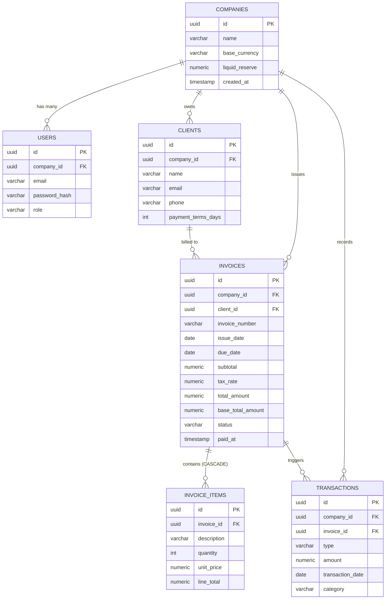

# FinFlow — Next.js 16 & PostgreSQL Master Implementation Plan
## Business Cash Flow Intelligence & Invoice SaaS
**Student:** Ahmad Aamir (`AF25LHB4554`)  
**Course:** CS2682 — Web Application Development  
**Architectural Paradigm:** Next.js 16 (Active LTS) App Router + PostgreSQL + Autonomous Microservice Domains  
**Status:** Living Engineering Blueprint & Execution Roadmap  

---

## Table of Contents
1. [Executive Summary & Architectural Paradigm](#1-executive-summary--architectural-paradigm)
2. [Target Tech Stack & Tooling (Next.js 16 Ecosystem)](#2-target-tech-stack--tooling-nextjs-16-ecosystem)
3. [Next.js 16 Core Architectural Primitives & Guidelines](#3-nextjs-16-core-architectural-primitives--guidelines)
   - [3.1 Cache Components Paradigm (`'use cache'`, `cacheLife`, `cacheTag`)](#31-cache-components-paradigm-use-cache-cachelife-cachetag)
   - [3.2 Multi-Tenant Cache Isolation & Leak Prevention](#32-multi-tenant-cache-isolation--leak-prevention)
   - [3.3 Strictly Asynchronous Request APIs (`await params`, `await cookies()`)](#33-strictly-asynchronous-request-apis-await-params-await-cookies)
   - [3.4 React 19 Native Actions & Optimistic State (`useActionState`, `useOptimistic`)](#34-react-19-native-actions--optimistic-state-useactionstate-useoptimistic)
4. [Global Database Topology (PostgreSQL 3NF)](#4-global-database-topology-postgresql-3nf)
5. [Phase-by-Phase Modular Implementation Plan](#5-phase-by-phase-modular-implementation-plan)
   - [Phase 0: Infrastructure, Base Scaffolding & Database Connection](#phase-0-infrastructure-base-scaffolding--database-connection)
   - [Phase 1: Microservice Domain 1 — Multi-Tenant Identity & Auth Service (`auth-tenant-service`)](#phase-1-microservice-domain-1--multi-tenant-identity--auth-service-auth-tenant-service)
   - [Phase 2: Microservice Domain 2 — Client Directory & CRM Service (`client-crm-service`)](#phase-2-microservice-domain-2--client-directory--crm-service-client-crm-service)
   - [Phase 3: Microservice Domain 3 — Invoicing Engine & Multi-Currency Service (`invoicing-service`)](#phase-3-microservice-domain-3--invoicing-engine--multi-currency-service-invoicing-service)
   - [Phase 4: Microservice Domain 4 — Document Generation & PDF Engine Service (`document-service`)](#phase-4-microservice-domain-4--document-generation--pdf-engine-service-document-service)
   - [Phase 5: Microservice Domain 5 — Treasury Ledger & 30-Day Forward Cash Flow Engine (`treasury-forecast-service`)](#phase-5-microservice-domain-5--treasury-ledger--30-day-forward-cash-flow-engine-treasury-forecast-service)
   - [Phase 6: Microservice Domain 6 — Visual Calendar & Scheduling Service (`schedule-calendar-service`)](#phase-6-microservice-domain-6--visual-calendar--scheduling-service-schedule-calendar-service)
   - [Phase 7: Microservice Domain 7 — Real-Time Synchronizer & Automated Reminders Service (`notification-sync-service`)](#phase-7-microservice-domain-7--real-time-synchronizer--automated-reminders-service-notification-sync-service)
   - [Phase 8: Microservice Domain 8 — Production Hardening, Security Audit & E2E Testing](#phase-8-microservice-domain-8--production-hardening-security-audit--e2e-testing)
6. [Phase 9: Academic Viva Defense & Examination Blueprint (Next.js 16 Focus)](#6-phase-9-academic-viva-defense--examination-blueprint-nextjs-16-focus)
7. [Execution Protocol: Phase Gate Workflow](#7-execution-protocol-phase-gate-workflow)

---

## 1. Executive Summary & Architectural Paradigm

FinFlow is an enterprise-grade FinTech SaaS engineered to solve the existential liquidity crisis facing Small and Medium Enterprises (SMEs). Instead of relying on static, backward-looking accrual bookkeeping (where invoices are recorded as revenue before payment is collected), FinFlow operates as a forward-looking liquid treasury cockpit.

### The Modular Microservice Architecture Pattern (Modular Monolith)
To achieve industrial-grade reliability, ease of grading, and zero technical debt, the application is structured as a **Modular Monolith partitioned into autonomous Domain Microservices** built atop the **Next.js 16 App Router**.

```
finflow/
├── next.config.ts                # Next.js 16 Config (cacheComponents: true, Turbopack)
├── src/
│   ├── app/                      # Next.js 16 App Router (RSC, Async Route Handlers, Layouts)
│   │   ├── (auth)/               # Auth route group
│   │   ├── (dashboard)/          # Authenticated app shell
│   │   └── api/                  # REST & SSE stream endpoints
│   ├── modules/                  # Autonomous Microservice Domains
│   │   ├── auth/                 # Domain 1: Multi-Tenant Identity & RBAC
│   │   ├── clients/              # Domain 2: Client Directory & CRM Ledger
│   │   ├── invoices/             # Domain 3: Atomic Invoicing Engine & Currency Rates
│   │   ├── documents/            # Domain 4: PDF Builder & Document Vault
│   │   ├── treasury/             # Domain 5: 30-Day Cash Flow Projection Engine
│   │   ├── calendar/             # Domain 6: Due-Date Scheduling & Visual Feed
│   │   └── notifications/        # Domain 7: Real-Time SSE Sync & Email Reminders
│   ├── components/               # Shared shadcn/ui & Radix UI primitives
│   ├── lib/                      # Database client (Prisma/Drizzle), utilities, logger
│   └── types/                    # Shared TypeScript schemas & DTOs
```

Each microservice domain possesses:
* **Dedicated Data Contracts:** Clear Zod schemas and TypeScript Data Transfer Objects (DTOs).
* **Isolated Service Logic:** Pure domain methods decoupled from HTTP transport.
* **Next.js 16 Server Actions:** Secure mutations leveraging React 19 `useActionState` and optimistic UI updates.
* **Strict Definition of Done (DoD):** A phase must pass 100% of unit, integration, and UI acceptance criteria before development advances to the next phase.

---

## 2. Target Tech Stack & Tooling (Next.js 16 Ecosystem)

| Component | Technology | Rationale in Next.js 16 |
| :--- | :--- | :--- |
| **Framework** | **Next.js 16.4+ (Active LTS)** | Default Turbopack engine, Cache Components model, React 19 compiler integration, and async request architecture. |
| **Runtime** | **Node.js 20.20+ / Bun 1.4+** | High-performance V8 runtime satisfying Next.js 16's modern async primitives. |
| **Language** | **TypeScript 5.x (Strict Mode)** | End-to-end type safety across database queries, Server Actions, and UI components. |
| **Database** | **PostgreSQL 15+ (Local / Supabase / Neon)** | ACID-compliant relational storage, strict decimal precision (`DECIMAL(14,2)`), and multi-tenant indexing. |
| **ORM / Data Layer** | **Prisma ORM** (or **Drizzle ORM**) | Type-safe migrations, auto-generated TypeScript clients, connection pooling singleton. |
| **UI Framework** | **Tailwind CSS + shadcn/ui (Radix UI)** | Zero-runtime CSS, fully accessible components compatible with React 19 Server Components. |
| **State & Cache Sync** | **React 19 `useOptimistic` + Next.js 16 Cache Tags** | Instant client-side state mutation with fine-grained server cache revalidation (`revalidateTag`). |
| **Visual Analytics** | **Chart.js** / **Recharts** | Rolling 30-day forward liquidity curves and accounts receivable aging charts. |
| **Calendar Engine** | **FullCalendar.js (React)** | Interactive schedule plotting due dates, cash collections, and scheduled expenditures. |
| **PDF Generation** | **jsPDF + AutoTable** (Client-side) | Instant browser-generated invoice PDFs without consuming server memory or incurring cold starts. |
| **External APIs** | **ExchangeRate-API** & **EmailJS** | Spot foreign exchange rates and browser-based transactional client reminders. |
| **Testing** | **Vitest** + **Playwright** | High-speed unit tests and full end-to-end user journey validation. |

---

## 3. Next.js 16 Core Architectural Primitives & Guidelines

### 3.1 Cache Components Paradigm (`'use cache'`, `cacheLife`, `cacheTag`)
Next.js 16 replaces the legacy `unstable_cache` with **Cache Components** enabled via `cacheComponents: true` in `next.config.ts`.
* Caching is explicit, granular, and declarative using the `'use cache'` directive.
* Cache duration is governed by `cacheLife` (e.g., `'minutes'`, `'hours'`, `'days'`).
* Invalidation is tag-driven via `cacheTag` and `revalidateTag`.

```typescript
// Example: Cached Public Exchange Rates in Next.js 16
import { unstable_cacheLife as cacheLife, unstable_cacheTag as cacheTag } from "next/cache";

export async function getCachedExchangeRates(baseCurrency: string) {
  "use cache";
  cacheLife("hours");
  cacheTag(`exchange-rates-${baseCurrency}`);

  const res = await fetch(`https://open.er-api.com/v6/latest/${baseCurrency}`);
  return await res.json();
}
```

### 3.2 Multi-Tenant Cache Isolation & Leak Prevention
> [!CAUTION]
> **Next.js 16 Multi-Tenant Rule:** In Next.js 16, calling `cookies()`, `headers()`, or reading un-awaited request params inside a standard `'use cache'` scope throws a build error to prevent cross-tenant data leaks.

**The Golden Pattern for FinFlow Multi-Tenancy:**
1. **Read Request Context Outside:** Read `await cookies()` or session tokens in the parent Server Component or Layout.
2. **Pass Explicit Primitives:** Pass the tenant identifier (`companyId`) into the cached domain function as an argument. The argument automatically becomes part of the cache key.
3. **Explicit Tenant Tagging:** Always tag tenant caches with `cacheTag(`company-${companyId}-${domain}`)`.
4. **Use `'use cache: private'`:** For user-specific profile states where data must never leak to a shared cache.

```typescript
// Multi-tenant safe cache pattern
export async function getTenantTreasuryStats(companyId: string) {
  "use cache";
  cacheLife("minutes");
  cacheTag(`company-${companyId}-treasury`);

  // Query is strictly scoped to this companyId
  return await prisma.company.findUnique({
    where: { id: companyId },
    select: { liquidReserve: true, baseCurrency: true },
  });
}
```

### 3.3 Strictly Asynchronous Request APIs (`await params`, `await cookies()`)
In Next.js 16, dynamic route parameters, search queries, cookies, and headers are strictly asynchronous promises:

```typescript
// app/invoices/[id]/page.tsx
import { cookies, headers } from "next/headers";

interface InvoicePageProps {
  params: Promise<{ id: string }>;
  searchParams: Promise<{ view?: string }>;
}

export default async function InvoiceDetailPage({ params, searchParams }: InvoicePageProps) {
  // 1. Must await dynamic route parameters
  const { id } = await params;
  const { view } = await searchParams;

  // 2. Must await cookies and headers
  const cookieStore = await cookies();
  const sessionToken = cookieStore.get("finflow_session")?.value;
  const headersList = await headers();
  const userAgent = headersList.get("user-agent");

  return <InvoiceView invoiceId={id} defaultView={view} />;
}
```

### 3.4 React 19 Native Actions & Optimistic State (`useActionState`, `useOptimistic`)
Next.js 16 natively leverages React 19's Action model, eliminating the need for boilerplate state management libraries:
* `useActionState`: Manages pending states, validation errors, and returned payloads from Server Actions.
* `useOptimistic`: Instantly toggles invoice status (e.g., from "Sent" to "Paid") and increments treasury counters before the server round-trip completes.

---

## 4. Global Database Topology (PostgreSQL 3NF)



---

## 5. Phase-by-Phase Modular Implementation Plan

### Phase 0: Infrastructure, Base Scaffolding & Database Connection
* Next.js 16 (Turbopack) initialization.
* Strict TypeScript, ESLint, Tailwind CSS, shadcn/ui.
* Zod environment validator (`src/lib/env.ts`).
* Prisma connection singleton (`src/lib/prisma.ts`).
* Health check endpoint `/api/health`.

### Phase 1: Microservice Domain 1 — Multi-Tenant Identity & Auth Service (`auth-tenant-service`)
* Schema: `Company`, `User` with roles (`OWNER`, `FINANCE_MANAGER`, `AUDITOR`).
* Actions: `registerCompany`, `loginUser`.
* Bcrypt cryptographic hashing, session cookie management via `await cookies()`.
* Tenant guard middleware intercepting protected routes.

### Phase 2: Microservice Domain 2 — Client Directory & CRM Service (`client-crm-service`)
* Schema: `Client` with contact details and payment terms (Net-15/30/60).
* Ledger calculations: Total Billed, Outstanding, Aging Overdue balances.
* Client CRUD with optimistic UI updates.

### Phase 3: Microservice Domain 3 — Invoicing Engine & Multi-Currency Service (`invoicing-service`)
* Schema: `Invoice`, `InvoiceItem`.
* Atomic transaction via `prisma.$transaction`.
* Spot currency conversion with ExchangeRate-API.
* Server-side total calculation verification.

### Phase 4: Microservice Domain 4 — Document Generation & PDF Engine Service (`document-service`)
* Client-side vector PDF generation via `jsPDF + AutoTable`.
* Print-ready stylesheets.

### Phase 5: Microservice Domain 5 — Treasury Ledger & 30-Day Forward Cash Flow Engine (`treasury-forecast-service`)
* Schema: `Transaction` (INFLOW / OUTFLOW).
* Mathematical forward liquidity model over 30 days.
* Cash bottleneck/deficit alert detection.
* Interactive Chart.js / Recharts area curve.

### Phase 6: Microservice Domain 6 — Visual Calendar & Scheduling Service (`schedule-calendar-service`)
* FullCalendar.js integration.
* Due dates and planned expense spikes mapped on month/week calendar.

### Phase 7: Microservice Domain 7 — Real-Time Synchronizer & Automated Reminders Service (`notification-sync-service`)
* Optimistic UI status mutation with React 19 `useOptimistic`.
* Server-Sent Events (SSE) stream for cross-tab synchronization.
* 1-click automated payment reminders dispatched via EmailJS.

### Phase 8: Microservice Domain 8 — Production Hardening, Security Audit & E2E Testing
* SQL injection and XSS defense audits.
* Cache tag namespacing audit.
* Vitest unit tests + Playwright E2E browser tests.

---

## 6. Phase 9: Academic Viva Defense & Examination Blueprint (Next.js 16 Focus)
Detailed answers for CS2682 examiners covering Next.js 16 Cache Components, Partial Prerendering (PPR), async request APIs, PostgreSQL ACID transactions, and liquidity modeling.

---
*FinFlow Engineering Plan updated on November 12, 2026 for Ahmad Aamir (AF25LHB4554).*
