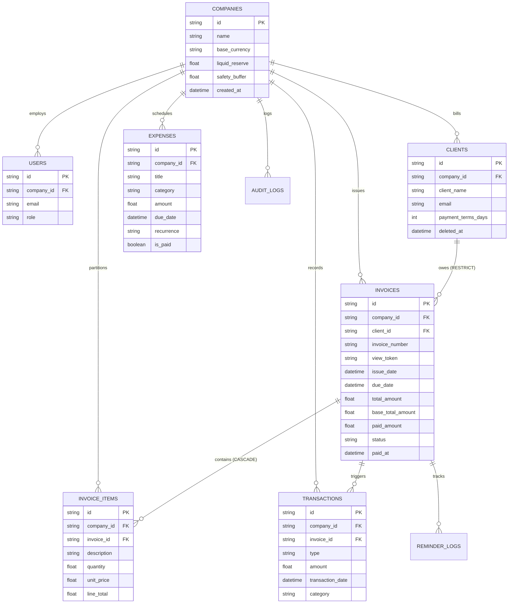

<div align="center">

# 🌊 FinFlow
### Business Cash Flow Intelligence & Invoice SaaS
**Empowering SMEs with Forward-Looking Liquid Treasury Forecasting, Dynamic Multi-Currency Invoicing, and Real-Time Receivables Synchronization.**

[](https://nextjs.org/)
[](https://react.dev/)
[](https://www.typescriptlang.org/)
[](https://bun.sh/)
[](https://www.sqlite.org/)
[](https://www.prisma.io/)
[](https://tailwindcss.com/)
[](LICENSE)

</div>

---

## 📌 Overview & Problem Statement

Cash flow mismanagement is empirically the **#1 reason Small and Medium Enterprises (SMEs) fail** within their first three years of operation. While businesses often record nominal accounting profits, they frequently suffer fatal liquidity crises because their capital remains trapped in extended Accounts Receivable (A/R) cycles.

Traditional accounting software focuses heavily on backward-looking accrual bookkeeping—counting invoices as revenue the moment they are issued, regardless of when cash is collected. Basic spreadsheets, on the other hand, lack dynamic forward-looking forecasting, automated follow-ups, and real-time state synchronization.

**FinFlow** bridges this divide by acting as a modern financial operations cockpit for SMEs:
* **Forward Liquidity Forecasting:** Algorithmic 30-day cumulative rolling cash curve mapping receivables to contractual due dates (weighted by historical client latency) and deducting scheduled expenses.
* **Cash Deficit Alerts:** Early warning signals identifying the exact calendar day an SME will breach its liquid safety buffer.
* **Atomic Multi-Currency Invoicing:** Instant multi-line invoice issuance backed by ACID transactions and spot exchange rates.
* **Public Tokenized Payment Portal:** Unauthenticated guest link (`/pay/[token]`) allowing clients to view and download invoices without hitting business login walls.
* **Zero-Friction Local Persistence:** Backed by an ACID-compliant **SQLite** database via Prisma ORM for 100% offline portability and instant academic evaluation, with seamless one-line migration to PostgreSQL for cloud production.

---

## 🏛️ Architectural Topology: Domain-Driven Modular Monolith

FinFlow is architected as an industrial-grade **Domain-Driven Modular Monolith (Clean Architecture)** built natively on the **Next.js 16 App Router**:

```
finflow/
├── next.config.ts                # Next.js 16 Config (cacheComponents: true, Turbopack)
├── proxy.ts                      # Next.js 16 Request Interceptor (Node.js runtime)
├── prisma/
│   ├── schema.prisma             # Relational 3NF SQLite Database Schema
│   └── dev.db                    # Zero-config local SQLite database
├── src/
│   ├── app/                      # Next.js 16 App Router (RSC, Async Route Handlers, Layouts)
│   │   ├── (auth)/               # Tenant authentication route group
│   │   ├── (dashboard)/          # Authenticated cockpit application shell
│   │   ├── pay/                  # Public tokenized invoice portal (/pay/[token])
│   │   ├── dev/ui/               # UI Design System Component Kit
│   │   └── api/                  # REST & SSE stream endpoints
│   ├── modules/                  # Autonomous Domain Modules
│   │   ├── auth/                 # Domain 1: Multi-Tenant Identity & RBAC
│   │   ├── clients/              # Domain 2: Client Directory, A/R Ledger, 5-Bucket Aging
│   │   ├── invoices/             # Domain 3: Atomic Invoicing Engine & Spot Currency Rates
│   │   ├── documents/            # Domain 4: jsPDF Document Builder & Token Portal
│   │   ├── expenses/             # Domain 5: Operational Outflows & Scheduled Expenses
│   │   ├── treasury/             # Domain 6: 30-Day Forward Forecast & Runway Engine
│   │   ├── calendar/             # Domain 7: Due-Date Scheduling & Visual Feed
│   │   └── notifications/        # Domain 8: Real-Time SSE Sync & Email Reminders
│   ├── components/               # Shared shadcn/ui & Radix UI primitives
│   ├── lib/                      # Database client (Prisma), utilities, logger, math
│   └── types/                    # Shared TypeScript schemas & DTOs
```

---

## ⚡ Core Features

### 1. Multi-Tenant Identity & Workspace Isolation
* Tenant isolation with company-scoped workspaces.
* Secure authentication using salted bcrypt password hashing, encrypted HTTP-only session cookies, and `proxy.ts` request interception.
* Configurable workspace parameters: Base currency (PKR, USD, EUR, GBP), opening liquid cash, and explicit safety buffer threshold.

### 2. Client CRM & Accounts Receivable Ledger
* Scoped customer profiles with contact records and contractual payment terms (Net-15, Net-30, Net-60).
* Relational integrity: Clients cannot be deleted if active historical invoices exist (`onDelete: Restrict`).
* Real-time normalized ledger aggregations: Total Billed, Total Collected, Outstanding Receivables, and 5-Bucket Aging distribution (Current, 1–30, 31–60, 61–90, 90+ days).

### 3. Atomic Multi-Currency Invoicing Engine
* Dynamic multi-row invoice builder with server-side validation and atomic database commits (`prisma.$transaction`).
* Multi-currency support fetching spot exchange rates via ExchangeRate-API with normalized base currency calculations.
* Atomic sequential invoice numbering generator per tenant/year (`INV-YYYY-XXXX`).

### 4. Expense & Scheduled Outflow Management
* Track fixed and operational business expenditures (payroll, rent, software subscriptions, suppliers).
* Expansion of recurring commitments (weekly, monthly, quarterly) across the 30-day forecast horizon.

### 5. 30-Day Forward Cash Flow Intelligence
* Mathematical liquidity projection incorporating opening cash, the Day-0 overdue recovery pool (with risk haircut), maturing receivables (weighted by historical client latency), and scheduled expenses:
  $$\text{Projected Balance}(t) = \text{Liquid Reserve}_0 + \text{Overdue Pool} + \sum_{d=1}^{t} \text{Expected Inflows}(d) - \sum_{d=1}^{t} \text{Scheduled Outflows}(d)$$
* Interactive **Chart.js** liquidity visualization against the company's designated safety buffer.
* Automated deficit markers alerting finance managers before reserves dip below safe operational levels.

### 6. Document Engine & Public Tokenized Portal
* Instant vector PDF invoice compilation via `jsPDF` and `jspdf-autotable` directly inside the browser with UTF-8 currency font support.
* Public tokenized view route (`/pay/[token]`) enabling unauthenticated clients to inspect invoices and download PDFs.

### 7. Interactive Due-Date Financial Calendar
* FullCalendar.js view mapping receivables and expense spikes across month, week, and list views.
* Standardized status styling matching the FinFlow design tokens.

### 8. Real-Time State Sync & Client Reminders
* Zero-refresh optimistic UI mutations powered by React 19 and Next.js 16 `updateTag()`.
* 1-click automated payment reminders dispatched directly to client inboxes via EmailJS with valid public payment links.

---

## 🛠️ Tech Stack & Tooling

| Tier | Technology | Description |
| :--- | :--- | :--- |
| **Framework** | **Next.js 16** | App Router, Turbopack, React 19 Server Components, and Server Actions |
| **Runtime & PM** | **Bun 1.4+** | Fast package management, script execution, and development runtime |
| **Language** | **TypeScript 5.x** | Strict end-to-end type safety |
| **Database** | **SQLite 3** | ACID-compliant relational persistence, foreign keys, zero-config local `dev.db` file (100% offline viva-ready, 1-line portable to PostgreSQL) |
| **ORM** | **Prisma ORM 7.x / 8.x** | Type-safe schema, migrations, connection singleton, `$transaction` |
| **Math Precision** | **`decimal.js`** | Arbitrary-precision math for all currency and treasury calculations |
| **Styling & UI** | **Tailwind CSS v4 + shadcn/ui** | Modern, light-only banking-grade UI strictly bound to `FINFLOW_UI_DESIGN_SYSTEM.md` |
| **Charts** | **Chart.js + react-chartjs-2** | Responsive SVG/Canvas liquidity trajectory and safety buffer reference curves |
| **Calendar** | **FullCalendar.js (React)** | Interactive billing and maturity schedule |
| **PDF Generation** | **jsPDF + AutoTable** | Client-side instant vector PDF export with UTF-8 support |
| **External APIs** | **ExchangeRate-API & EmailJS** | Spot foreign exchange rates and transactional reminder emails |
| **Testing** | **Vitest + Playwright** | Unit, integration, and end-to-end browser test suites |

---

## 🗄️ Database Architecture (Relational 3NF)



---

## 🚀 Getting Started

### Prerequisites
* **Bun:** `v1.4+` (or **Node.js:** `v20+`)
* **Git:** Latest version

### Installation & Local Setup

1. **Clone the repository:**
   ```bash
   git clone https://github.com/ahmad-006/finflow.git
   cd finflow
   ```

2. **Install dependencies:**
   ```bash
   bun install
   ```

3. **Configure Environment Variables:**
   Create a `.env` file in the root directory:
   ```env
   # Database (Local SQLite - zero config, works 100% offline)
   DATABASE_URL="file:./dev.db"

   # Authentication
   SESSION_SECRET="your-super-secret-random-key-at-least-32-chars"
   NEXT_PUBLIC_APP_URL="http://localhost:3000"

   # External APIs (Optional / Free Tier)
   EXCHANGE_RATE_API_KEY=""
   NEXT_PUBLIC_EMAILJS_SERVICE_ID=""
   NEXT_PUBLIC_EMAILJS_TEMPLATE_ID=""
   NEXT_PUBLIC_EMAILJS_PUBLIC_KEY=""
   ```

4. **Initialize Database Schema:**
   ```bash
   bunx prisma db push
   ```

5. **Start Development Server (with Turbopack):**
   ```bash
   bun dev
   ```
   Open [http://localhost:3000](http://localhost:3000) to view the application.

---

## 📋 Implementation Roadmap & Phase Gates

Development follows a strict **Phase Gate Protocol** where each domain module must meet 100% of its Definition of Done (DoD) and pass automated tests before progressing:

- [ ] **Phase 0:** Infrastructure, Base Scaffolding & SQLite Prisma Connection Singleton
- [ ] **Phase 1:** Multi-Tenant Identity & Auth Service (`auth-tenant`)
- [ ] **Phase 2:** Client Directory & Accounts Receivable Ledger (`clients-crm`)
- [ ] **Phase 3:** Invoicing Engine & Multi-Currency Calculation Service (`invoicing`)
- [ ] **Phase 4:** Document Generation & Public Tokenized Portal (`documents`)
- [ ] **Phase 5:** Expense Management & Scheduled Outflows (`expenses`)
- [ ] **Phase 6:** Treasury Ledger & 30-Day Forward Cash Flow Engine (`treasury-forecast`)
- [ ] **Phase 7:** Visual Calendar & Scheduling Service (`calendar`)
- [ ] **Phase 8:** Real-Time State Sync & Automated Reminders (`notifications-sync`)
- [ ] **Phase 9:** Production Hardening, Security Audit & E2E Testing Suite (`audit-testing`)
- [ ] **Phase 10:** Academic Viva Defense & Examination Master Readiness

---

## 🎓 Academic Project Context

* **Course:** CS2682 — Web Application Development
* **Institution:** Riphah International University
* **Student:** Ahmad Aamir
* **Roll Number:** `AF25LHB4554`
* **Assignment Project #:** 8 (FinFlow — Business Cash Flow Intelligence & Invoice SaaS)

---

## 📄 License
This project is licensed under the MIT License — see the [LICENSE](LICENSE) file for details.
